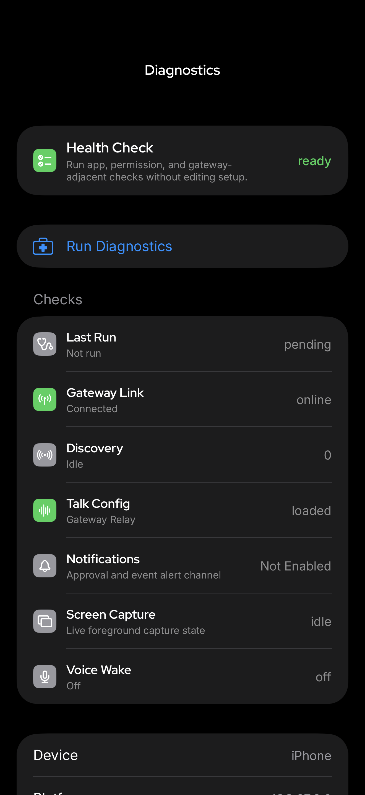
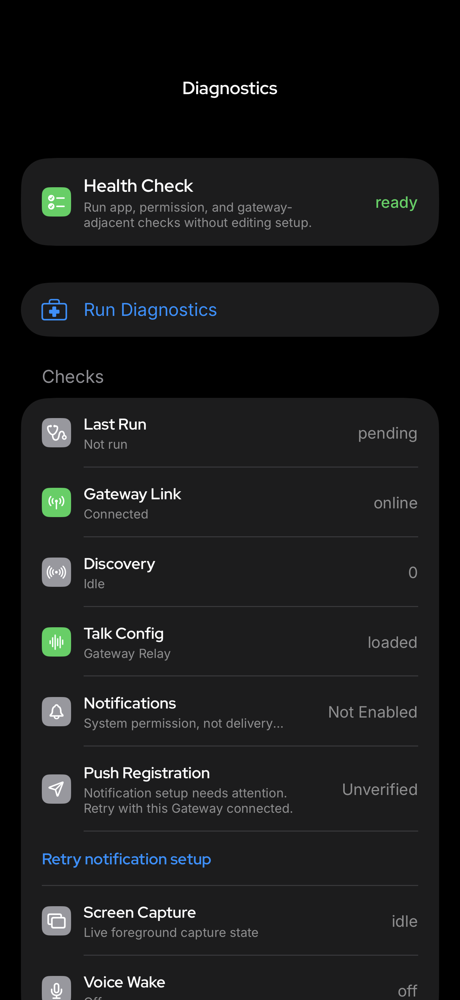
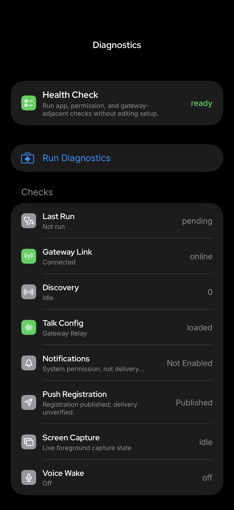

# PR #191565 — code and proof handoff

**Handoff-only evidence. Not intended for inclusion in the product PR.** The parent of this evidence commit is the reviewed source candidate. Take the code commits through the existing PR's normal workflow; keep this directory as review evidence, not production code. No merge/readiness approval or notification-delivery success is asserted. Status below is the preparation snapshot, not a live GitHub status.

## Source to review

- Existing PR: [#191565](https://github.com/openclaw/openclaw/pull/191565).
- Original issue: [#120241](https://github.com/openclaw/openclaw/issues/120241).
- Reviewed original PR head: [`613212b1e5d0f0bb8aa351e021fe2c8764ae0642`](https://github.com/openclaw/openclaw/commit/613212b1e5d0f0bb8aa351e021fe2c8764ae0642).
- Pinned target main: [`c9d9baced1f1d7b3ef05f1cea5100e9db5ab7bd1`](https://github.com/openclaw/openclaw/commit/c9d9baced1f1d7b3ef05f1cea5100e9db5ab7bd1). This is not a claim to latest main.
- History-preserving local refresh: `ec086b1edf3ddb7b2da19ef978cfa18b380eb9fe`. Pinned merge completed automatically; no manual conflict edits.
- **Final source candidate: `579aa20dc9d9d2167c875de325d2c49435cfea79`.**
- **Validated source tree: `c73d8fc06bd5f1f458e0aa58fed3d49d1ea3243e`.**

The code candidate preserves original PR history and TheAngryPit's contributor credit. The final cleanup imports the Mac-supplied nine-file Swift patch exactly; no lint thresholds or suppressions changed. Adding this proof directory does not alter that validated source.

## Proof ledger

| Check | Result | Revision and provenance |
|---|---|---|
| APNs/Gateway/schema regression tests | 326 passed across eight files | Executed on refresh parent `ec086b1ed`; final cleanup is Swift-only and tested TS/schema sources are byte-identical. Reused proof, not a new-head rerun. |
| Canonical schema generator | Verified | Executed on refresh parent; generated schema source unchanged by cleanup. |
| Focused type-aware TypeScript lint | Zero warnings/errors, 14 changed source/test files | Executed on exact `579aa20dc`; [raw output](linux-focused-lint.txt). Supported wrapper/default rules. |
| iOS Simulator build | Passed | Mac-supplied report on tracked source matching final candidate. Not independently rerun on Linux. |
| Three focused Swift suites | 28 passed, zero failures/skips | Supplied Xcode log ends TEST SUCCEEDED. Suites: PushRegistrationRecoveryTests, SettingsNetworkingHelpersTests, OpenClawTypographyTests. |
| Swift lint/format | Zero violations / no formatting changes required | Mac-supplied log and top-level lint report; no rule relaxation. |
| macOS compilation | Passed, exit 0, 70.24 seconds; warnings only | Mac-supplied `swift build --package-path apps/macos`, Swift 6.4.2; source verification matches final commit/tree and all nine blobs; all six affected macOS object files verified in supplied report. |
| Static review | No actionable high-confidence regressions | Original cross-layer, independently reconstructed refresh, and native cleanup reviews; static review is not device execution or landing approval. |
| Screenshot inspection | Four complete, sanitized frames; hashes verified | Rendered UI fixtures on matching candidate UI; detailed qualifications below. |

Native full logs/result bundles were supplied privately in the working conversation, not copied into this public proof directory because they contain machine-local paths and build environment details. The machine-readable [evidence ledger](evidence.json) distinguishes direct execution from supplied evidence. The [source manifest](native-source-manifest.json) records every imported base/result blob. No private signing material, credentials, relay grants, raw APNs tokens, or build environments are included.

### Regression test selection

- `src/infra/push-apns.test.ts`
- `src/infra/push-apns.store.test.ts`
- `src/infra/push-apns-store.read-kernel.test.ts`
- `src/gateway/server-node-events.test.ts`
- `src/gateway/server-methods/nodes.apns-registration.test.ts`
- `src/gateway/server-methods/push.test.ts`
- `test/scripts/generate-postgres-schema.test.ts`
- `test/scripts/sqlite-schema-catalog-equivalence.test.ts`

## Inspected before/after Diagnostics screenshots

All four images are original pixels inspected in chat; their SHA-256 hashes and capture metadata are in evidence.json. Captures use synthetic UI state in a task-owned Simulator with no production Gateway enrollment. No Diagnostics or Retry action was invoked. These images prove rendering only, NOT token reacquisition, relay enrollment/publication, recovery execution, or notification receipt.

**Before qualification:** exact pinned-main Diagnostics UI owner compiled in the candidate app shell, NOT a complete pinned-main runtime build. Dark appearance, Large Dynamic Type; after states use the candidate UI owner. The Notifications explanatory caption is ellipsized at this viewport; the complete registration warning remains visible.

### Before — pinned-main UI owner

### After — needs retry

### After — recovering

### After — published; delivery unverified

## Remaining blockers and owner continuation

1. **Official signing + physical-device proof.** Tester has an iPhone and Personal Team signing, but no official-relay-capable candidate. Request an authorized official TestFlight candidate. A tester need not purchase developer membership. Follow [device acceptance](DEVICE-ACCEPTANCE.md); do not weaken relay proofs or alter production credentials/pairings.
2. **Maintainer contract decision.** Accept/reject the registration-scoped persistent rejection and recovery-budget semantics independently from test success.
3. **Hosted CI and current-head review.** Candidate has not run full hosted CI. Existing draft PR's passing dispatch/label jobs are not runtime validation. Earlier broad local `check:changed` was not green: an unused `MEMORY_PROVENANCE_CHECK_ID` in `src/commands/doctor-memory-provenance.ts` was independently reproduced on clean pinned main. No unrelated repair/ignore was added. Broad wrapper timed out, but focused final-candidate lint later passed.
4. **Coordinated publication.** This is a separate fork handoff, not an upstream branch overwrite or competing PR. Recheck upstream head before adopting the code; do not force-push or request review of a stale source revision. Include the screenshot evidence in the eventual PR update. [Coordination draft](PR-COMMENT-DRAFT.md) is not a posted comment.

Do not rerun already-passing unchanged source merely for handoff; changes require affected proof to be refreshed. Keep all unresolved gates explicit, and do not equate successful enrollment/publication with actual notification delivery.
